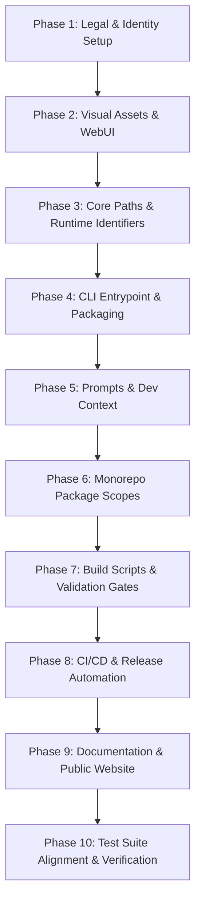

# Brand Audit: Migration to "helloglitch"

> **Audit Date:** 2026-10-28  
> **Repository:** `helloglitch` (formerly `deepseek-harness`)  
> **Target Brand Name:** `helloglitch`  
> **Mode:** Read-only repository analysis  
> **Status:** Completed  

---

## Executive Summary

This audit catalogs every brand asset, package namespace, CLI entry point, UI component, environment variable, installer script, prompt, documentation file, and CI workflow referencing **DeepSeek**, **deepseek**, **dsh**, **DSH**, **@deepseek-ai**, **deepseek-harness**, **whale/logo branding**, and the **Cordis** framework where it functions as product branding.

The codebase comprises **10,325 files** containing **141,666 occurrences** of these brand terms. While documentation and test suites represent the largest volume, rebranding critical runtime surfaces (package scopes, CLI commands, user home paths, and SVG icons) requires strict sequencing to avoid breaking dependencies, session replay baselines, and cross-platform installation mechanics.

---

## BRAND_GUIDELINES.md Analysis

`BRAND_GUIDELINES.md` (and its counterpart `BRAND_GUIDELINES.zh.md`) defines the legal and trademark specifications established by DeepSeek for third-party use of the DeepSeek Harness name and official brand assets:

1. **Relationship Descriptions (Permitted with Accuracy):**
   - Projects may use "DeepSeek Harness" in descriptive copy strictly to describe compatibility or lineage (e.g., *"built on DeepSeek Harness"*, *"compatible with DeepSeek Harness"*).
   - Such usage complies with open-source license obligations and clarifies project positioning.
2. **Project Naming Recommendation (Abbreviation Only):**
   - If a community project desires to indicate association with the ecosystem, it is advised to use the abbreviation **"DSH"** (e.g., `my-tool-dsh`).
3. **Trademark Restrictions (Strictly Prohibited):**
   - Direct, unadorned use of the full trademark **"DeepSeek Harness"** as a project title is prohibited without authorization.
   - *"DeepSeek Harness"* is a registered trademark of DeepSeek. Unauthorized usage causes consumer confusion and creates potential trademark infringement liability.
4. **Brand Materials & Logo Assets (False Endorsement Bar):**
   - Official logos, wordmarks, and graphical materials (such as the DeepSeek whale icon) must not be used in promotional materials, presentations, or interfaces in any manner implying official endorsement, joint venture, or corporate authorization.
5. **Enforcement & Adjustment Rights:**
   - DeepSeek reserves the right to contact project owners and request immediate adjustments to preserve ecosystem clarity.

> [!IMPORTANT]
> A complete rebrand to **"helloglitch"** completely eliminates trademark infringement risks by substituting official DeepSeek trademarks and whale assets with distinct helloglitch naming and iconography, retaining DeepSeek references strictly where communicating upstream API compatibility or open-source copyright.

---

## Detailed Audit by Category

Each section below categorizes identified brand references with file paths, characterization, and assigned risk levels:
- **Safe:** Visual copy, user-facing text, documentation, UI strings, marketing prose.
- **Needs Care:** Package namespaces, CLI commands, IPC channels, environment variables, config directories, test suite gates, build pipelines.
- **Do Not Touch:** Legal licenses, upstream vendor code, third-party notices, historical snapshot fixture replays, third-party patch files.

---

### 1. Identifiers & Package Metadata

| Sub-Item | File Path / Pattern | Current Identifier | Proposed `helloglitch` Equivalent | Risk Level |
| :--- | :--- | :--- | :--- | :--- |
| **Monorepo Scope** | All `package.json` files | `@deepseek-ai/dsh-*` (369 packages) | `@helloglitch/*` or `@helloglitch/hg-*` | Needs Care |
| **Root Package** | `package.json` | `@deepseek-ai/dsh-root` | `@helloglitch/root` | Needs Care |
| **CLI Package** | `apps/cli/package.json` | `@deepseek-ai/dsh` | `@helloglitch/cli` | Needs Care |
| **CLI Bin Field** | `apps/cli/package.json` | `"bin": { "dsh": "lib/bin.js" }` | `"bin": { "helloglitch": "lib/bin.js", "hg": "lib/bin.js" }` | Needs Care |
| **Web App Package** | `apps/web/package.json` | `@deepseek-ai/dsh-web-frontend` | `@helloglitch/web` | Needs Care |
| **Desktop App Package** | `apps/desktop/package.json` | `@deepseek-ai/dsh-desktop` | `@helloglitch/desktop` | Needs Care |
| **Desktop Host Package** | `apps/desktop-host/package.json` | `@deepseek-ai/dsh-desktop-host` | `@helloglitch/desktop-host` | Needs Care |
| **Market Generator** | `apps/plugin-market-generator/package.json` | `@deepseek-ai/dsh-plugin-market-generator` | `@helloglitch/plugin-market-generator` | Needs Care |
| **Website Package** | `website/package.json` | `@deepseek-ai/website` | `@helloglitch/website` | Needs Care |
| **Benchmarks Package**| `benchmarks/package.json` | `@deepseek-ai/dsh-benchmarks` | `@helloglitch/benchmarks` | Needs Care |
| **Native System Addons**| `native/system/package.json` `native/system/packages/*/package.json` | `@deepseek-ai/node-addon-system*` (6 packages) | `@helloglitch/node-addon-system*` | Needs Care |
| **Python SDK** | `python/sdk/pyproject.toml` | `name = "deepseek-harness-sdk"` `authors = [{ name = "DeepSeek" }]` | `name = "helloglitch-sdk"` `authors = [{ name = "helloglitch" }]` | Needs Care |
| **Python Bundled Bin**| `python/sdk-runtime/pyproject.toml` | `name = "deepseek-harness-runtime-bin"` | `name = "helloglitch-runtime-bin"` | Needs Care |
| **Python Runtime Closure**| `python/sdk-runtime/package.json` | `"name": "dsh-python-runtime-closure"` | `"name": "helloglitch-python-runtime-closure"` | Needs Care |
| **Packer Utility Bin** | `packages/experimental/webworker-packer/package.json` | `"bin": { "dsh-pack-vfs-image": "./bin.js" }` | `"bin": { "hg-pack-vfs-image": "./bin.js" }` | Needs Care |
| **Home Dir Name** | `packages/util/home-paths/src/index.ts` | `DSH_HOME_DIR_NAME = '.dsh'` | `HG_HOME_DIR_NAME = '.helloglitch'` | Needs Care |
| **Home Display** | `packages/util/home-paths/src/index.ts` | `DEFAULT_DSH_HOME_DISPLAY = '~/.dsh'` | `DEFAULT_HG_HOME_DISPLAY = '~/.helloglitch'` | Needs Care |
| **Home Env Var** | `packages/util/home-paths/src/index.ts` | `DSH_HOME_ENV = 'DSH_HOME'` | `HG_HOME_ENV = 'HELLOGLITCH_HOME'` | Needs Care |
| **Agents Shared Root**| `packages/util/home-paths/src/index.ts` | `AGENTS_HOME_ENV = 'DSH_AGENTS_HOME'` | `HG_AGENTS_HOME_ENV = 'HELLOGLITCH_AGENTS_HOME'` | Needs Care |
| **Path Utilities** | `packages/util/home-paths/src/index.ts` | `resolveDshHome`, `dshHomePath`, `dshCachePath`, `dshHomeDisplay` | `resolveHgHome`, `hgHomePath`, `hgCachePath`, `hgHomeDisplay` | Needs Care |
| **Desktop App ID** | `apps/desktop/scripts/desktop-release-environment.mjs` `apps/desktop/.env.windows.example` | `com.deepseek.dsh` | `com.helloglitch.desktop` | Needs Care |
| **Desktop URL Protocol**| `apps/desktop/scripts/electron-builder-config.mjs` | `protocols: [{ name: 'DeepSeek Harness', schemes: ['dsh'] }]` | `protocols: [{ name: 'helloglitch', schemes: ['helloglitch', 'hg'] }]` | Needs Care |
| **Environment Variables**| Repo-wide (410 distinct vars) | `DSH_*` (e.g. `DSH_CLIENT_VERSION`, `DSH_BUILD_FACE`, `DSH_SNAPSHOT`) | `HELLOGLITCH_*` or `HG_*` | Needs Care |
| **Provider Env Vars** | `packages/llm/llm-deepseek/`, `packages/web/web-search-deepseek/` | `DEEPSEEK_API_KEY`, `DEEPSEEK_BASE_URL` | Keep for DeepSeek API provider adapter | Needs Care |

---

### 2. CLI (Command-Line Interface)

| Surface | File Path | Current Content | Action for `helloglitch` | Risk Level |
| :--- | :--- | :--- | :--- | :--- |
| **Entry Point** | `apps/cli/src/bin.ts` | `# Command-line entry for dsh` `@module @deepseek-ai/dsh/bin` `loadLayeredEnv('dsh')` `resolveDshHome()` | Update module JSDoc, environment namespace (`loadLayeredEnv('helloglitch')`), and home path resolver. | Needs Care |
| **CLI Arguments & Help** | `apps/cli/src/args.ts` | `program.name('dsh')` `description('dsh: boot a DeepSeek Harness profile...')` `dsh web`, `dsh headless`, `dsh tui` | Rename program to `helloglitch` / `hg`, update help text and examples. | Safe |
| **CLI Diagnostics** | `apps/cli/src/startup-diagnostics.ts` | Reports referencing `dsh` launch errors and `$DSH_HOME` | Update diagnostics formatting and environment references. | Safe |
| **TUI Banner Gradient** | `.agents/notes/archived/feature/2026-07-21-tui-banner-brand-gradient.md` | Paints `DEEPSEEK` in 24-bit truecolor gradient `#4D6BFE` → `#3982FF` → `#2498FF` with `HARNESS` in bold. | Replace with `HELLOGLITCH` brand gradient and typography. | Safe |
| **TUI Welcome Screen** | `.agents/notes/archived/feature/2026-07-30-versioned-tui-first-run-welcome.md` | Samples 24×24 official DeepSeek whale SVG at terminal resolution with `#4D6BFE`. | Update ASCII/block raster glyph to new helloglitch logo. | Safe |
| **Subcommands** | `apps/cli/src/args.ts` | `dsh plugin --profile <name>` | Maintain subcommand semantics (`hg plugin`). | Safe |

---

### 3. WebUI & Desktop Client

| Component | File Path | Current Asset / Behavior | Action for `helloglitch` | Risk Level |
| :--- | :--- | :--- | :--- | :--- |
| **Whale Logo SVG** | `packages/client/ui-primitives/src/FishLogo.tsx` | `FISH_LOGO_PATH` (exact bezier path of DeepSeek whale) `FISH_LOGO_VIEWBOX = { width: 23.16, height: 17.04 }` `FishLogo` component | Replace SVG path data and viewBox with the new helloglitch brand mark. | Safe |
| **Official Wordmark** | `packages/client/ui-primitives/src/BrandWordmark.tsx` | SVG paths for "DEEPSEEK" letters, "HARNESS" badge, and `dsh-wordmark-whale-clip` | Redesign with the helloglitch wordmark. | Safe |
| **Official Brand Injections**| `packages/client/ui-brand-official/src/client/Brand.tsx` | `OfficialBrandMark` (renders `FishLogo`) `OfficialBrandName` (renders `BrandWordmark`) | Update slot occupants for `sidebar.brand.mark` and `sidebar.brand.name`. | Safe |
| **Empty Hero Whale Animation**| `packages/client/ui-conversation/src/client/skeleton/EmptyHero.tsx` | `HeroFish` SMIL hover swim morph using `HERO_SWIM_UP_PATH` and `HERO_SWIM_DOWN_PATH` | Replace or restyle the hero logo entrance / idle animation. | Safe |
| **Sidebar Brand Header**| `packages/client/ui-sidebar/src/client/SidebarRoot.tsx` | Fallback mark: `<FishLogo size={24} />` Fallback name: `t('brand.localBuild')` | Ensure fallback uses new helloglitch logo. | Safe |
| **LiveShare Viewer Brand**| `packages/experimental/liveshare/src/client/viewer-brand.tsx` | Uses `FishLogo` and `BrandWordmark` | Replace with helloglitch branding. | Safe |
| **Web Shell Title & Favicon**| `apps/web/index.html` | `<title>DSH Local Build</title>` `apple-mobile-web-app-title="DSH"` `href="/favicon.svg"` | Update `<title>`, meta tags, and favicon references to helloglitch. | Safe |
| **Web App Manifest** | `apps/web/public/manifest.webmanifest` | `"name": "DeepSeek Harness"`, `"short_name": "DSH"` | Update to `"name": "helloglitch"`, `"short_name": "helloglitch"`. | Safe |
| **Favicons & Touch Icons**| `apps/web/public/favicon.svg` `apps/web/public/favicon-dark.svg` `apps/web/public/icon-*.png` `website/public/favicon.svg` | DeepSeek whale silhouettes in `#4D6BFE` and monochrome | Replace all favicon assets with helloglitch icons. | Safe |
| **CSS Brand Font** | `packages/client/ui-theme/src/styles/brand-font.css` | Montserrat font used for the official brand font stack | Retain or swap font family to match helloglitch brand guidelines. | Safe |
| **CSS Tokens & Prefixes** | `packages/client/ui-theme/src/styles/base.css` | `--dsh-font-family-*`, `--dsw-font-family-brand`, `--dsw-alias-brand-primary: #4d6bfe`, `[data-dsh-automatic-focus]` | Rename token prefixes to `--hg-` / `--helloglitch-` or alias them for backward compatibility. | Needs Care |
| **Onboarding i18n Strings**| `packages/client/ui-settings-account/src/client/locales/onboarding.ts` | `onboardingBrand: 'DeepSeek Harness'` across 8 languages (zh, en, ja, es, fr, de, ru, pt) | Replace with `'helloglitch'` across all language dictionaries. | Safe |
| **Client Plugin Locales**| `packages/client/*/locale/*.json` | Translations referencing "DeepSeek 品牌展示", "管理 DeepSeek 登录", etc. | Update localized titles and descriptions. | Safe |

---

### 4. Prompts, Personas & System Context

| Subsystem | File Path | Current Content | Action for `helloglitch` | Risk Level |
| :--- | :--- | :--- | :--- | :--- |
| **Harness Dev Context** | `packages/context/harness-dev-context/src/index.ts` | `HARNESS_SOURCE_PROMPT = 'The runtime context names the DeepSeek Harness implementation checkout...'` `'Use this checkout only to inspect or extend DSH itself.'` `WEB_SURFACE_PROMPT = 'You are interacting with the user through the DeepSeek Harness Web GUI...'` | Update prompt sentences to name `helloglitch`. Note: preserve legacy paragraph parsers for old session compatibility. | Needs Care |
| **Persona Plugin** | `packages/preset/persona/` | `@deepseek-ai/dsh-persona` Package description: `"Composition-authored deployment persona section for the DeepSeek Harness"` | Rename package and description; retain persona injection mechanism. | Safe |
| **Web App Bundle Preset**| `packages/bundle/web-app/cordis.patch.yml` | `serviceName: deepseek-harness-desktop` | Update OTel service name to `helloglitch-desktop`. | Safe |
| **Built-in Agent Skills**| `packages/preset/agent-preset/skills/*` | `cordis-plugin-development/SKILL.md` `cordis-composition-reference/SKILL.md` | Update skill instructions referencing DSH workflows and repository conventions. | Safe |

---

### 5. Installers & Native Packaging

| Installer Surface | File Path | Current Branding | Action for `helloglitch` | Risk Level |
| :--- | :--- | :--- | :--- | :--- |
| **Windows NSIS Installer Config**| `apps/desktop/scripts/electron-builder-config.mjs` | `productName: 'DeepSeek Harness'` `artifactName: 'deepseek-harness-${version}-${os}-${arch}...'` `protocols: [{ name: 'DeepSeek Harness', schemes: ['dsh'] }]` | Change product name to `helloglitch`, artifact prefix to `helloglitch-`, URL schemes to `['helloglitch', 'hg']`. | Needs Care |
| **Windows Installer Assets**| `apps/desktop/installer/assets/` | `brand.png`, `brand-2x.png`, `brand-dark.png`, `brand-dark-2x.png`, `uninstaller-sidebar.png` | Replace installer header images and uninstaller sidebars with helloglitch assets. | Safe |
| **Windows Installer Locales**| `apps/desktop/installer/locales/*.json` (8 languages) | `"INSTALLER_LAUNCH_FAILED": "DeepSeek Harness could not be launched..."` `"INSTALLER_RUNNING": "DeepSeek Harness is running..."` | Update strings across all 8 NSIS locale JSON files to "helloglitch". | Safe |
| **Desktop App ID & Signing**| `apps/desktop/scripts/desktop-release-environment.mjs` `apps/desktop/.env.windows.example` | `DSH_DESKTOP_APP_ID=com.deepseek.dsh` `DSH_DESKTOP_WINDOWS_SIGNATURE_CACHE_DIR` | Update App ID to `com.helloglitch.desktop` and cache dir to `.helloglitch-desktop-signing`. | Needs Care |
| **macOS Bundle Info** | `apps/desktop/scripts/electron-builder-config.mjs` | `CFBundleLocalizations` `NSMicrophoneUsageDescription: 'DeepSeek Harness uses your microphone...'` | Update microphone permissions description to "helloglitch". | Safe |
| **Python SDK Wheel Builder**| `scripts/build-python-release.py` | Wheels named `deepseek_harness_sdk-*.whl` and `deepseek_harness_runtime_bin-*.whl` | Rename wheels and PyPI targets to `helloglitch_sdk` and `helloglitch_runtime_bin`. | Needs Care |
| **Python Runtime Exe Generator**| `scripts/build-exe-for-python-sdk.ts` | Builds executable: `dist-exe/deepseek-harness-sdk-runtime-<platform>` | Rename standalone executable to `dist-exe/helloglitch-sdk-runtime-<platform>`. | Needs Care |

---

### 6. Documentation, Website & Public Repositories

| Document | File Path | Current References | Action for `helloglitch` | Risk Level |
| :--- | :--- | :--- | :--- | :--- |
| **Project READMEs** | `README.md` `README.zh.md` | `# DeepSeek Harness` `npx @deepseek-ai/dsh web` `git clone https://github.com/deepseek-ai/deepseek-harness.git` `https://deepseek-harness.github.io/deepseek-harness/` Discord / community links | Replace with `# helloglitch`, new `npx helloglitch web` commands, new repository URLs, and helloglitch community links. | Safe |
| **Contributing Guidelines**| `CONTRIBUTING.md` `CONTRIBUTING.zh.md` | References to DeepSeek developer workflow and CLA | Update contribution process for helloglitch. | Safe |
| **Safety Notice** | `SAFETY.md` `SAFETY.zh.md` | Safety disclosures for DeepSeek Harness | Update project name to helloglitch. | Safe |
| **Agent Instructions** | `AGENTS.md` `CLAUDE.md` | Architectural rules referencing `@deepseek-ai/dsh-*`, `pnpm dsh`, Cordis vendor layout | Update instructions to reflect `@helloglitch/*` package paths and new commands. | Safe |
| **Documentation Tree** | `docs/**/*.md` (hundreds of guides) | `docs/architecture.md`, `docs/cordis-primer.md`, `docs/cordis-tutorial/` | Update user-facing docs to helloglitch; clarify that Cordis is the underlying architectural microkernel. | Safe |
| **Shields.io Badges** | `apps/cli/tests/dsh-badge.expected.e2e.ts` `docs/**/*.md` | `badge/powered_by-dsh-4D6BFE?style=flat-square&logo=deepseek&logoColor=white` | Replace with helloglitch badges and brand color. | Safe |
| **Documentation Website**| `website/.vitepress/config.ts` `website/package.json` `website/docs.ts` | Title: "DeepSeek Harness", logo, metadata, GitHub links | Rebrand VitePress configuration, title, logo, and nav links. | Safe |
| **Historical Agent Notes**| `.agents/notes/` | 1,000+ historical design notes | Historical record; frozen per repository rules. Update only if actively maintaining notes index. | Safe |

---

### 7. CI/CD & Automation Workflows

| Pipeline | File Path | Current Content | Action for `helloglitch` | Risk Level |
| :--- | :--- | :--- | :--- | :--- |
| **GitHub Workflows** | `.github/workflows/*.yml` (32 workflows) | Package publishing under `@deepseek-ai/*`, repository targets, `DEEPSEEK_API_KEY` secret injection, PR check scripts | Update publish scope to `@helloglitch`, repository references, release tags (`v*`), and artifact naming. | Needs Care |
| **GitLab CI** | `.gitlab-ci.yml` | Python package publishing (`deepseek-harness-sdk`, `deepseek-harness-runtime-bin`) to GitLab PyPI registry | Update package names and repository paths. | Needs Care |
| **Makefile** | `Makefile` | `pnpm dsh web` targets, help descriptions | Update CLI commands to `pnpm hg web` / `pnpm helloglitch web`. | Safe |
| **Dockerfiles** | `packages/ssh/ssh-helper-runtime/tests/fixtures/sshd/Dockerfile` | Test SSH daemon fixture | Test fixture only; review for any brand assumptions. | Safe |
| **GitHub Issue Templates**| `.github/ISSUE_TEMPLATE/*` | Bug, feature, task templates referencing DeepSeek Harness | Update headers and links. | Safe |

---

### 8. Tests & Validation Gates

| Test Suite | File Path | Dependency on Brand Strings | Action for `helloglitch` | Risk Level |
| :--- | :--- | :--- | :--- | :--- |
| **Package License Gate** | `scripts/verify-dsh-package-licenses.ts` `scripts/verify-dsh-package-licenses.spec.ts` | Asserts every package matches `@deepseek-ai/dsh-*` and has valid license metadata. | Rename script to `verify-package-licenses.ts` and update scope regex to `@helloglitch/*`. | Needs Care |
| **Cordis Config Gate** | `scripts/verify-cordis-config.ts` `scripts/verify-cordis-config.spec.ts` | Verifies bare plugin dependencies in `cordis.yml`. | Update package name references. | Needs Care |
| **Repository References Gate**| `scripts/verify-repository-references.ts` `scripts/verify-repository-references.spec.ts` | Checks GitHub URL formats and repo links. | Update expected repo URLs from `deepseek-ai/deepseek-harness` to `helloglitch/helloglitch`. | Needs Care |
| **CLI Built-Bin E2E** | `apps/cli/tests/built-bin.e2e.ts` `apps/cli/tests/args.spec.ts` | Asserts `dsh --help`, usage banner, version output. | Update expected string assertions to `helloglitch` / `hg`. | Needs Care |
| **Badge E2E Tests** | `apps/cli/tests/dsh-badge.expected.e2e.ts` | Asserts exact Shields.io markdown string. | Update test assertions to expect helloglitch badge syntax. | Needs Care |
| **Web Client Unit Tests** | `packages/client/*/tests/*.spec.ts` | Tests checking titlebar, brand mark slot injection, onboarding flow. | Update component test fixtures and assertions. | Needs Care |

---

### 9. Protected Assets & Upstream Code ("Do Not Touch")

The following surfaces **must not be rebranded** or modified carelessly, as doing so would violate software licenses, invalidate upstream credits, break external dependencies, or corrupt recorded session replay verifications:

| Surface | File Paths | Reason to Retain / Protect | Risk Level |
| :--- | :--- | :--- | :--- |
| **License Copyright** | `LICENSE` | Retain original copyright notices: `Copyright (c) 2026 DeepSeek` alongside `Copyright (c) 2026 helloglitch` to preserve legal copyright provenance under the MIT license. | **Do Not Touch** |
| **Third-Party Notices** | `THIRD_PARTY_NOTICES.md` `scripts/gen-third-party-notices.ts` | Documents upstream direct dependencies, licenses, and vendored code origins. Must be regenerated rather than hand-edited. | **Do Not Touch** |
| **Vendored Cordis Code** | `vendor/cordis/` `vendor/cosmokit/` `vendor/schemastery/` `vendor/group/` `vendor/hmr/` `vendor/include/` `vendor/loader/` `vendor/logger-console/` `vendor/timer/` | Vendored upstream framework code. While packages were locally rescoped to `@deepseek-ai/cordis`, changing vendor package names requires running `scripts/rescope-vendor.ts` and carefully maintaining upstream git sync tracking in `vendor/README.md`. | **Do Not Touch** |
| **Third-Party Patches** | `patches/@yao-pkg__pkg@6.21.0.patch` `patches/node-pty@1.2.0-beta.15.patch` etc. | Patches applied by pnpm to third-party node_modules. Notice `patches/node-pty@1.2.0-beta.15.patch` reads `DSH_NODE_PTY_SPAWN_HELPER`. Only touch if coordinating runtime variable changes. | **Do Not Touch** |
| **Historical Snapshots** | `snapshots/session/` (1,046+ files) `snapshots/acp/` `snapshots/sdk/` `snapshots/web/` | Committed session JSONL recordings are cryptographic/deterministic test baselines for session format migrations. Modifying strings in historical session files corrupts session hashes and invalidates migration tests. | **Do Not Touch** |
| **DeepSeek LLM Adapter** | `packages/llm/llm-deepseek/` `packages/web/web-search-deepseek/` | Adapters providing real API access to DeepSeek models (`DEEPSEEK_API_KEY`, API endpoints, reasoning modes). Must retain DeepSeek name because they interface with DeepSeek's external services. | **Do Not Touch** |

---

## Occurrence Statistics by Category

The following table summarizes the occurrences of brand terms (`deepseek`, `DeepSeek`, `dsh`, `DSH`, `@deepseek-ai`, `deepseek-harness`) across the repository:

| Category | File Count | Occurrences | Primary Risk Level |
| :--- | :---: | :---: | :---: |
| **Identifiers & Metadata** (package.json, bins, config paths, env vars) | 2,170 | 41,145 | Needs Care |
| **CLI & Commands** (entry point, args parser, banners, diagnostic tools) | 16 | 849 | Needs Care |
| **WebUI & Desktop Client** (SVGs, wordmarks, theme tokens, onboarding copy) | 939 | 8,803 | Safe |
| **Prompts & Personas** (harness-dev-context, persona definitions) | 25 | 275 | Needs Care |
| **Installers & Packaging** (NSIS scripts, installer assets, Python wheels) | 8 | 42 | Needs Care |
| **Documentation & Prose** (READMEs, docs, tutorials, website, notes) | 3,349 | 41,901 | Safe |
| **CI/CD & Workflows** (GitHub Actions, GitLab CI, Makefile, issue tools) | 33 | 252 | Needs Care |
| **Tests & Verification Gates** (unit, e2e, gate scripts, expected outputs) | 2,739 | 34,470 | Needs Care |
| **Protected Assets** (LICENSE, THIRD_PARTY_NOTICES, vendor code, snapshots) | 1,046 | 13,929 | **Do Not Touch** |
| **TOTAL** | **10,325** | **141,666** | — |

---

## Recommended Order of Changes (Phased Rebrand Plan)

A rebrand of this magnitude must proceed in controlled, dependency-ordered phases. Attempting package renaming before updating validation gates or asset pipelines will break builds and test suites across the monorepo.

### Phase 1: Legal & Identity Setup
1. Retain existing `Copyright (c) 2026 DeepSeek` in `LICENSE` and append `Copyright (c) 2026 helloglitch`.
2. Reserve the npm organization scope `@helloglitch` and PyPI package names (`helloglitch-sdk`, `helloglitch-runtime-bin`).
3. Define official helloglitch color palette, typography, and brand identity specifications.

### Phase 2: Visual Assets & WebUI
1. Replace SVG artwork in `packages/client/ui-primitives/src/FishLogo.tsx` and `BrandWordmark.tsx` with the new helloglitch mark and wordmark.
2. Update `packages/client/ui-conversation/src/client/skeleton/EmptyHero.tsx` with new hero logo animation.
3. Update `apps/web/public/` favicons (`favicon.svg`, `favicon-dark.svg`, `icon-192.png`, `icon-512.png`, `manifest.webmanifest`).
4. Update web page titles in `apps/web/index.html` to `helloglitch Local Build`.
5. Update localized onboarding copy in `packages/client/ui-settings-account/src/client/locales/onboarding.ts` and client locale JSON files.

### Phase 3: Core Paths & Runtime Identifiers
1. In `packages/util/home-paths/src/index.ts`, change home directory from `.dsh` to `.helloglitch`, environment override to `HELLOGLITCH_HOME` (maintaining fallback reading of `DSH_HOME` for existing profiles).
2. Update desktop application identifier to `com.helloglitch.desktop` and custom URL scheme to `helloglitch://` / `hg://`.
3. In `apps/desktop/scripts/electron-builder-config.mjs`, update `productName` to `helloglitch`.

### Phase 4: CLI Entrypoint & Packaging
1. Update `apps/cli/src/bin.ts` and `apps/cli/src/args.ts`:
   - Change CLI binary name to `helloglitch` and alias `hg`.
   - Update help descriptions and error messages.
2. Update TUI startup banner to `HELLOGLITCH` with the new brand color gradient.
3. Update Windows NSIS installer locales and assets in `apps/desktop/installer/`.

### Phase 5: Prompts, Personas & Development Context
1. Update `packages/context/harness-dev-context/src/index.ts` to output `"helloglitch implementation checkout"` and `"helloglitch Web GUI"`.
2. Preserve `LEGACY_SOURCE` and `LEGACY_WEB_SURFACE` fallback patterns so existing sessions can be resumed without prompt invalidation.
3. Update `packages/preset/persona/` package description and default persona strings.

### Phase 6: Monorepo Package Scopes & Dependencies
1. Systematically rename package names across `packages/*/*/package.json` and `apps/*/package.json`:
   - `@deepseek-ai/dsh-<pkg>` $\rightarrow$ `@helloglitch/<pkg>`.
2. Update all internal cross-package `dependencies`, `peerDependencies`, and `devDependencies` using `pnpm -r exec`.
3. Update `tsconfig.base.json` path mappings.
4. Run `pnpm install` to update `pnpm-lock.yaml`.

### Phase 7: Build Scripts & Validation Gates
1. Update validation scripts in `scripts/`:
   - `scripts/verify-dsh-package-licenses.ts` $\rightarrow$ `scripts/verify-package-licenses.ts`
   - `scripts/verify-package-dependencies.ts`
   - `scripts/verify-package-meta.ts`
   - `scripts/verify-repository-references.ts`
2. Update `scripts/rescope-vendor.ts` if rescoping vendor packages from `@deepseek-ai` to `@helloglitch`.
3. Regenerate `THIRD_PARTY_NOTICES.md` using `pnpm run gen-third-party-notices`.

### Phase 8: CI/CD & Release Automation
1. Update GitHub Actions workflows in `.github/workflows/` with new repository URLs, secret names, and publish tokens.
2. Update `.gitlab-ci.yml` Python build pipeline.
3. Update `Makefile` shortcuts.

### Phase 9: Documentation & Public Website
1. Update root markdown files: `README.md`, `README.zh.md`, `CONTRIBUTING.md`, `SAFETY.md`, `AGENTS.md`, `CLAUDE.md`.
2. Update documentation site in `website/.vitepress/config.ts` and documentation files under `docs/`.
3. Replace Shields.io badges.

### Phase 10: Test Suite Alignment & Verification
1. Run `pnpm run build` to confirm clean compilation across host and client artifacts.
2. Run focused test suites: `pnpm run test` and `pnpm run test:expected`.
3. Run `pnpm run hygiene` (publint, workspace dependency checks).
4. For snapshot replays (`pnpm run test:snapshot`), verify whether keyless recorded sessions pass normalizer filters or require designated snapshot refresh.
